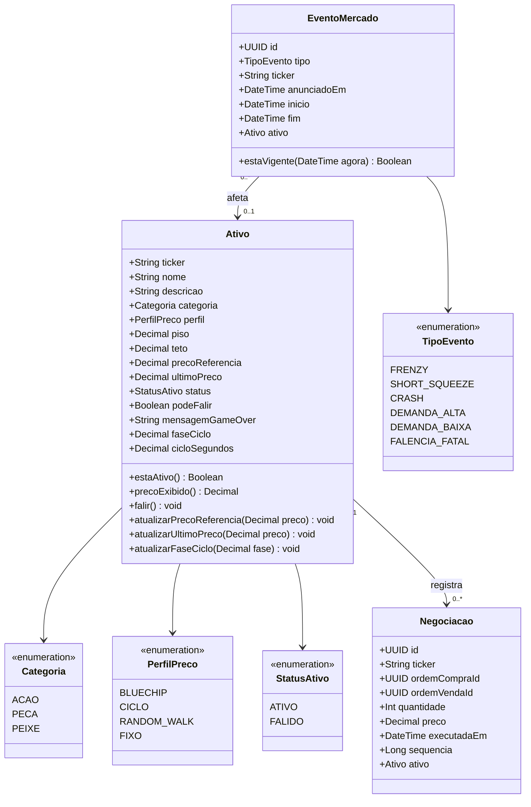
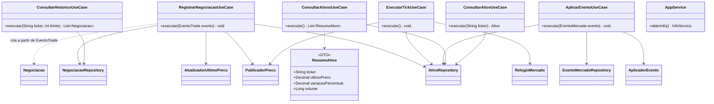
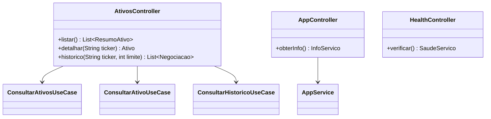
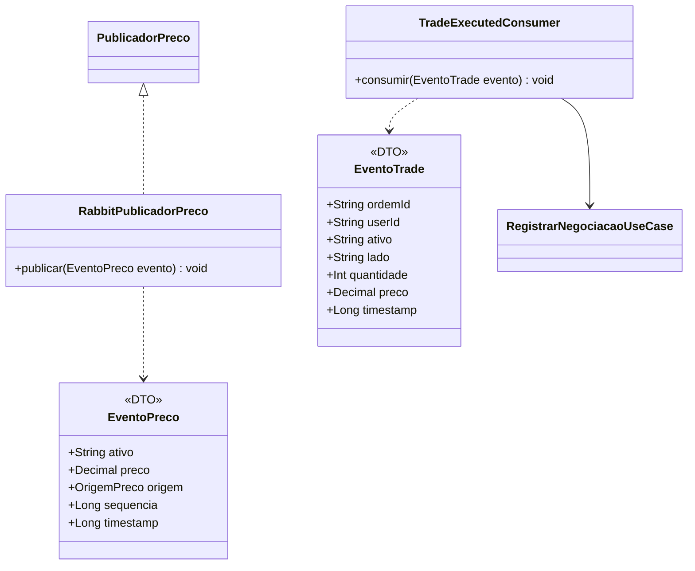

# Market Data — diagramas de classes por pasta

**Escopo:** apenas o microserviço `market data` (Serviço de Mercado: catálogo de ativos, relógio e preço de referência).

**Estrutura atual:**

```text
src/
├── controller/
├── database/
├── domain/
│   ├── ports/
│   └── services/
└── usecases/

config/
└── ativos.json   (catálogo inicial, RF23/RNF08)
```

As classes abaixo são as do desenho do microserviço; as que ainda não existem indicam o destino previsto em cada pasta.

---

## `src/domain` — entidades e enums



---

## `src/domain` — serviços e portas

```mermaid
classDiagram
  class RelogioMercado {
    -PoliticasPorPerfil politicas
    -int intervaloTickMs
    -Map~String,Long~ ultimoTick
    +tick(Ativo ativo, DateTime agora) Decimal
  }

  class PoliticaPreco {
    <<interface>>
    +proximoPreco(Ativo ativo) Decimal
    +avancar(Ativo ativo, long intervaloMs) void
  }

  class PoliticaBluechip {
    +proximoPreco(Ativo ativo) Decimal
  }

  class PoliticaCiclo {
    +proximoPreco(Ativo ativo) Decimal
  }

  class PoliticaRandomWalk {
    +proximoPreco(Ativo ativo) Decimal
  }

  class PoliticaFixo {
    +proximoPreco(Ativo ativo) Decimal
  }

  class AplicadorEvento {
    +aplicar(EventoMercado evento, Ativo ativo) void
  }

  class AtualizadorUltimoPreco {
    +aplicar(Ativo ativo, Negociacao negociacao) void
  }

  class AtivoRepository {
    <<interface>>
    +salvar(Ativo ativo) Promise
    +buscarPorTicker(String ticker) Promise~Ativo?~
    +listar() Promise~List~Ativo~~
  }

  class NegociacaoRepository {
    <<interface>>
    +salvar(Negociacao negociacao) Promise
    +listarPorTicker(String ticker, int limite) Promise~List~Negociacao~~
  }

  class EventoMercadoRepository {
    <<interface>>
    +salvar(EventoMercado evento) Promise
    +buscarVigente(String ticker, DateTime agora) Promise~List~EventoMercado~~
  }

  class PublicadorPreco {
    <<interface>>
    +publicar(EventoPreco evento) Promise
  }

  class EventoPreco {
    <<DTO>>
    +String ativo
    +Decimal preco
    +OrigemPreco origem
    +Long sequencia
    +Long timestamp
  }

  class OrigemPreco {
    <<enumeration>>
    TICK
    NEGOCIO
  }

  RelogioMercado --> PoliticaPreco : usa por PerfilPreco
  PoliticaPreco <|.. PoliticaBluechip
  PoliticaPreco <|.. PoliticaCiclo
  PoliticaPreco <|.. PoliticaRandomWalk
  PoliticaPreco <|.. PoliticaFixo

  AplicadorEvento --> EventoMercado
  AplicadorEvento --> Ativo
  AplicadorEvento --> StatusAtivo : FALENCIA_FATAL

  AtualizadorUltimoPreco --> Ativo
  AtualizadorUltimoPreco --> Negociacao

  PublicadorPreco ..> EventoPreco
  EventoPreco --> OrigemPreco
```



As políticas recebem uma `FonteAleatoria` (`() => number`, padrão `Math.random`) e parâmetros de amplitude no construtor, então são determinísticas nos testes. `PoliticaPreco.ts` também exporta `limitarAoIntervalo` e `arredondarPreco`, usados por todas as políticas. As portas de `src/domain/ports` exportam, junto da interface, o token de injeção do Nest (`ATIVO_REPOSITORY`, `NEGOCIACAO_REPOSITORY`, `EVENTO_MERCADO_REPOSITORY`, `PUBLICADOR_PRECO`).

`PoliticaCiclo` percorre uma senoide entre `piso` e `teto`: a fase fica em `Ativo.faseCiclo` e avança por `avancar(ativo, intervaloMs)` usando `cicloSegundos` (20–60 s, RF04), então o ciclo continua de onde parou após um restart (RNF06). O relógio é criado em `src/usecases/mercado.providers.ts`, que lê `TICK_MS` (padrão 1000) e `SEED_MERCADO`; com seed preenchida, `criarGeradorSemeado` (mulberry32) repete exatamente a mesma sequência de preços (RNF05).

---

## `src/usecases` — casos de uso e DTOs



`AppService` é o serviço atual do scaffold; os demais use cases ainda serão criados.

---

## `src/controller` — entradas HTTP



---

## `src/database` — persistência


`SeedService` roda no boot (`SEED_ON_STARTUP`, padrão ligado) e cria apenas os ativos que ainda não existem, então reiniciar o serviço não apaga preço nem status `FALIDO`. O catálogo vem de `config/ativos.json` (`CONFIG_PATH`), o que atende RF23 e RNF08.

---

## Fora das pastas atuais — integração com o broker

Ainda não existe pasta para os adaptadores de mensageria. Sugestão: criar `src/broker/`.



---

## Resumo por pasta

| Pasta | Classes |
|---|---|
| `src/domain` | `Ativo`, `Negociacao`, `EventoMercado`, enums, serviços de domínio e interfaces de repositório/publicação |
| `src/usecases` | `RegistrarNegociacaoUseCase`, `ExecutarTickUseCase`, `AplicarEventoUseCase`, `ConsultarAtivosUseCase`, `ConsultarAtivoUseCase`, `ConsultarHistoricoUseCase`, `AppService`, `ResumoAtivo`, `mercado.providers` |
| `src/controller` | `AtivosController`, `AppController`, `HealthController` |
| `src/database` | `DatabaseModule`, `SeedService`, `ativos.config` e implementações TypeORM dos repositórios |
| `src/broker` (a criar) | `TradeExecutedConsumer`, `RabbitPublicadorPreco`, `EventoTrade`, `EventoPreco` |