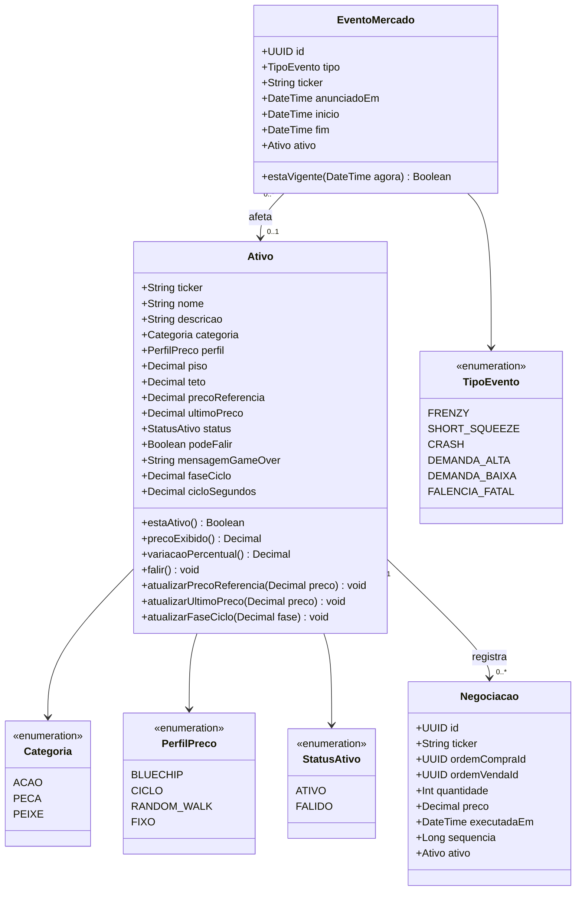
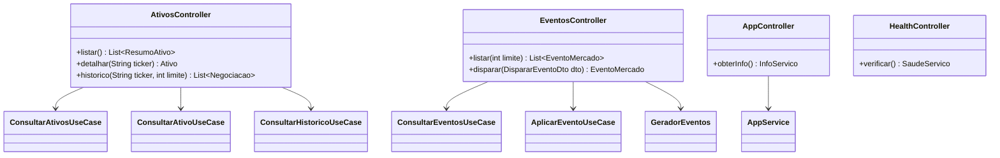
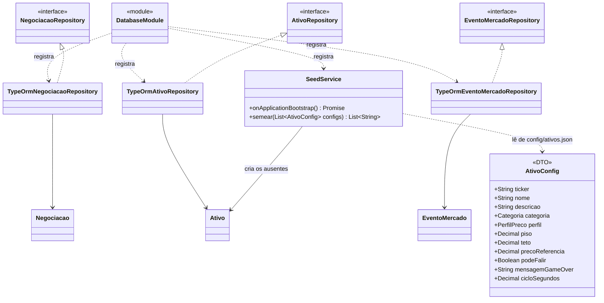
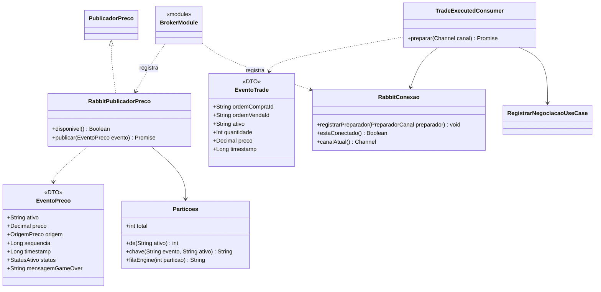

# Market Data — diagramas de classes por pasta

**Escopo:** apenas o microserviço `market data` (Serviço de Mercado: catálogo de ativos, relógio e preço de referência).

**Estrutura atual:**

```text
src/
├── controller/
├── database/
├── domain/
│   ├── ports/
│   └── services/
└── usecases/

config/
└── ativos.json   (catálogo inicial, RF23/RNF08)
```

As classes abaixo são as do desenho do microserviço; as que ainda não existem indicam o destino previsto em cada pasta.

---

## `src/domain` — entidades e enums



---

## `src/domain` — serviços e portas

```mermaid
classDiagram
  class RelogioMercado {
    -PoliticasPorPerfil politicas
    -int intervaloTickMs
    -Map~String,Long~ ultimoTick
    +tick(Ativo ativo, DateTime agora) Decimal
  }

  class PoliticaPreco {
    <<interface>>
    +proximoPreco(Ativo ativo) Decimal
    +avancar(Ativo ativo, long intervaloMs) void
  }

  class PoliticaBluechip {
    +proximoPreco(Ativo ativo) Decimal
  }

  class PoliticaCiclo {
    +proximoPreco(Ativo ativo) Decimal
  }

  class PoliticaRandomWalk {
    +proximoPreco(Ativo ativo) Decimal
  }

  class PoliticaFixo {
    +proximoPreco(Ativo ativo) Decimal
  }

  class SequenciaMercado {
    -long ultima
    +proxima() Long
  }

  class GeradorEventos {
    -FonteAleatoria aleatorio
    +proximoIntervaloMs() Long
    +criarRegular(List~Ativo~ alvos, DateTime agora) EventoMercado
    +criarFalencia(List~Ativo~ candidatos, DateTime agora) EventoMercado
    +criar(TipoEvento tipo, String ticker, DateTime agora, Long duracaoMs) EventoMercado
  }

  class AplicadorEvento {
    +aplicar(EventoMercado evento, Ativo ativo) void
  }

  class AtualizadorUltimoPreco {
    +aplicar(Ativo ativo, Negociacao negociacao) void
  }

  class AtivoRepository {
    <<interface>>
    +salvar(Ativo ativo) Promise
    +buscarPorTicker(String ticker) Promise~Ativo?~
    +listar() Promise~List~Ativo~~
  }

  class NegociacaoRepository {
    <<interface>>
    +salvar(Negociacao negociacao) Promise
    +listarPorTicker(String ticker, int limite) Promise~List~Negociacao~~
    +volumePorTicker() Promise~Map~String,Long~~
  }

  class EventoMercadoRepository {
    <<interface>>
    +salvar(EventoMercado evento) Promise
    +buscarVigente(String ticker, DateTime agora) Promise~List~EventoMercado~~
    +listar(int limite) Promise~List~EventoMercado~~
    +buscarFuturos(DateTime agora) Promise~List~EventoMercado~~
    +contarPorTipo(TipoEvento tipo) Promise~Long~
  }

  class PublicadorPreco {
    <<interface>>
    +publicar(EventoPreco evento) Promise
  }

  class EventoPreco {
    <<DTO>>
    +String ativo
    +Decimal preco
    +OrigemPreco origem
    +Long sequencia
    +Long timestamp
  }

  class OrigemPreco {
    <<enumeration>>
    TICK
    NEGOCIO
  }

  RelogioMercado --> PoliticaPreco : usa por PerfilPreco
  PoliticaPreco <|.. PoliticaBluechip
  PoliticaPreco <|.. PoliticaCiclo
  PoliticaPreco <|.. PoliticaRandomWalk
  PoliticaPreco <|.. PoliticaFixo

  AplicadorEvento --> EventoMercado
  AplicadorEvento --> Ativo
  AplicadorEvento --> StatusAtivo : FALENCIA_FATAL

  AtualizadorUltimoPreco --> Ativo
  AtualizadorUltimoPreco --> Negociacao

  PublicadorPreco ..> EventoPreco
  EventoPreco --> OrigemPreco
```



As políticas recebem uma `FonteAleatoria` (`() => number`, padrão `Math.random`) e parâmetros de amplitude no construtor, então são determinísticas nos testes. `PoliticaPreco.ts` também exporta `limitarAoIntervalo` e `arredondarPreco`, usados por todas as políticas. As portas de `src/domain/ports` exportam, junto da interface, o token de injeção do Nest (`ATIVO_REPOSITORY`, `NEGOCIACAO_REPOSITORY`, `EVENTO_MERCADO_REPOSITORY`, `PUBLICADOR_PRECO`).

`PoliticaCiclo` percorre uma senoide entre `piso` e `teto`: a fase fica em `Ativo.faseCiclo` e avança por `avancar(ativo, intervaloMs)` usando `cicloSegundos` (20–60 s, RF04), então o ciclo continua de onde parou após um restart (RNF06). O relógio é criado em `src/usecases/mercado.providers.ts`, que lê `TICK_MS` (padrão 1000) e `SEED_MERCADO`; com seed preenchida, `criarGeradorSemeado` (mulberry32) repete exatamente a mesma sequência de preços (RNF05).

`SequenciaMercado` é um contador monotônico (`proxima()`) usado como `sequencia` global dos preços publicados, para o cliente detectar eventos perdidos. Ele vive em memória e recomeça em 1 a cada boot.

---

## `src/usecases` — casos de uso e DTOs

```mermaid
classDiagram
  class RegistrarNegociacaoUseCase {
    +executar(EventoTrade evento) void
  }

  class ExecutarTickUseCase {
    +executar() void
  }

  class AplicarEventoUseCase {
    +executar(EventoMercado evento) void
  }

  class ConsultarAtivosUseCase {
    +executar() List~ResumoAtivo~
  }

  class ConsultarAtivoUseCase {
    +executar(String ticker) Ativo
  }

  class ConsultarHistoricoUseCase {
    +executar(String ticker, int limite) List~Negociacao~
  }

  class ConsultarEventosUseCase {
    +executar(int limite) List~EventoMercado~
  }

  class AgendadorTick {
    +onApplicationBootstrap() void
    +onApplicationShutdown() void
  }

  class AgendadorEventos {
    +onApplicationBootstrap() Promise
    +onApplicationShutdown() void
    +iniciar() Promise
  }

  class AppService {
    +obterInfo() InfoServico
  }

  class ResumoAtivo {
    <<DTO>>
    +String ticker
    +Decimal ultimoPreco
    +Decimal variacaoPercentual
    +Long volume
  }

  class EventoTrade {
    <<DTO>>
    +String ordemCompraId
    +String ordemVendaId
    +String ativo
    +Int quantidade
    +Decimal preco
    +Long timestamp
  }

  RegistrarNegociacaoUseCase --> AtivoRepository
  RegistrarNegociacaoUseCase --> NegociacaoRepository
  RegistrarNegociacaoUseCase --> AtualizadorUltimoPreco
  RegistrarNegociacaoUseCase --> PublicadorPreco
  RegistrarNegociacaoUseCase ..> Negociacao : cria a partir de EventoTrade

  ExecutarTickUseCase --> AtivoRepository
  ExecutarTickUseCase --> RelogioMercado
  ExecutarTickUseCase --> PublicadorPreco
  ExecutarTickUseCase --> SequenciaMercado

  AplicarEventoUseCase --> AplicadorEvento
  AplicarEventoUseCase --> AtivoRepository
  AplicarEventoUseCase --> EventoMercadoRepository
  AplicarEventoUseCase --> PublicadorPreco
  AplicarEventoUseCase --> SequenciaMercado

  ConsultarAtivosUseCase --> AtivoRepository
  ConsultarAtivosUseCase --> NegociacaoRepository : volume
  ConsultarAtivosUseCase ..> ResumoAtivo

  ConsultarAtivoUseCase --> AtivoRepository
  ConsultarHistoricoUseCase --> NegociacaoRepository
  ConsultarEventosUseCase --> EventoMercadoRepository

  AgendadorTick --> ExecutarTickUseCase
  AgendadorEventos --> GeradorEventos
  AgendadorEventos --> AplicarEventoUseCase
  AgendadorEventos --> AtivoRepository
  AgendadorEventos --> EventoMercadoRepository
```



`AppService` é o serviço atual do scaffold. `ConsultarAtivosUseCase` monta o `ResumoAtivo` de cada ativo (`ultimoPreco` = preço do último negócio ou o de referência, `variacaoPercentual` = variação sobre o preço de referência e `volume` = soma das quantidades negociadas, vinda de `volumePorTicker`) e é exposto em `GET /ativos`. `ConsultarAtivoUseCase` devolve o detalhe do ativo (`GET /ativos/:ticker`, 404 quando o ticker não existe). `ConsultarHistoricoUseCase` lê do `NegociacaoRepository` (mais recentes primeiro; limite padrão 50, máximo 200) e é exposto em `GET /ativos/:ticker/historico`. `ExecutarTickUseCase` percorre o catálogo, aplica o `RelogioMercado` e publica `price.updated` com origem `TICK` e o preço de referência; ativos `FALIDO` e ticks dentro do intervalo do relógio são ignorados, e a fase do ciclo é persistida mesmo quando o preço arredonda para o mesmo valor. `RegistrarNegociacaoUseCase` recebe um `EventoTrade` de `trade.executed`, grava a `Negociacao`, promove o preço a `ultimoPreco` pelo `AtualizadorUltimoPreco` e publica `price.updated` com origem `NEGOCIO`; execuções de ativo `FALIDO` são descartadas. `AplicarEventoUseCase` persiste o `EventoMercado`, aplica o efeito pelo `AplicadorEvento` nos ativos alvo (`ticker` nulo = todos os ativos ativos) e publica o preço pós-evento — inclusive a falência, que sai do tick e sem isso o GAME OVER nunca chegaria ao cliente (o `EventoPreco` leva `status` e `mensagemGameOver` nesse caso). `ConsultarEventosUseCase` expõe o histórico de eventos em `GET /eventos`.

`AgendadorTick` dispara o tick a cada `TICK_MS`. `AgendadorEventos` completa o ciclo de eventos (RF12/RF13/RF20/RNF10): sorteia um evento regular a cada 45–90 s, grava o anúncio 5 s antes do efeito, reagenda no boot o que ficou persistido com `inicio` no futuro e agenda a falência uma única vez por sessão (2–5 min, alvo entre os ativos `podeFalir`), gravando-a **antes** do disparo para não repetir nem perder após uma queda. `EVENTOS_INTERVALO_MS`, `EVENTOS_BRIEFING_MS` e `EVENTOS_ENABLED` existem para acelerar ou desligar a demo. `POST /eventos` (RF22) dispara um evento na hora pelo mesmo `AplicarEventoUseCase`.

O rastro de eventos (RNF07) sai em quatro marcas com o mesmo `evento=<id>`, prontas para `grep`: `EVENT_SCHEDULED` (falência agendada), `EVENT_ANNOUNCED` (briefing), `EVENT_TRIGGERED` e `PRICE_ADJUSTED` (com `de=`/`para=` e, na falência, `status=`/`gameOver=`). A demo de falha controlada (RNF09) é o script `app/scripts/demo-falha-market-data.ps1`.

A `sequencia` da negociação e do `EventoPreco` vem do `SequenciaMercado`, que também é usado pelo `AplicarEventoUseCase`.

Sobre `OrigemPreco`: `TICK` leva o preço de referência (o que alimenta o gráfico a cada segundo) e `NEGOCIO` leva o preço do último negócio (o preço "exibido" ao jogador, Q7). Os dois use cases são registrados no `AppModule`; o `PUBLICADOR_PRECO` vem do `BrokerModule`.

---

## `src/controller` — entradas HTTP



---

## `src/database` — persistência



`SeedService` roda no boot (`SEED_ON_STARTUP`, padrão ligado) e cria apenas os ativos que ainda não existem, então reiniciar o serviço não apaga preço nem status `FALIDO`. O catálogo vem de `config/ativos.json` (`CONFIG_PATH`), o que atende RF23 e RNF08.

`TypeOrmEventoMercadoRepository.buscarVigente` devolve os eventos de um ticker cujo `inicio <= agora <= fim`, incluindo os globais (`ticker` nulo).

---

## `src/broker` — integração com o broker

`RabbitConexao` usa a recuperação automática do amqplib 2.x: a cada reconexão o canal é recriado e os preparadores rodam de novo, então consumo e declarations voltam sozinhos após uma queda do broker.



`Particoes` reproduz `Particoes.java` do serviço de ordens (hash do Java + `floorMod`), então `price.updated.p{N}.{ativo}` cai na mesma partição nos dois serviços. O consumidor assina `trade.executed.*.*` na fila `q.mercado` (DLQ `cruel.dlq`); mensagem recusada vai para a DLQ sem requeue.

---

## Resumo por pasta

| Pasta | Classes |
|---|---|
| `src/domain` | `Ativo`, `Negociacao`, `EventoMercado`, enums, serviços de domínio e interfaces de repositório/publicação |
| `src/usecases` | `RegistrarNegociacaoUseCase`, `ExecutarTickUseCase`, `AplicarEventoUseCase`, `ConsultarAtivosUseCase`, `ConsultarAtivoUseCase`, `ConsultarHistoricoUseCase`, `ConsultarEventosUseCase`, `AgendadorTick`, `AgendadorEventos`, `AppService`, `ResumoAtivo`, `mercado.providers` |
| `src/controller` | `AtivosController`, `EventosController`, `AppController`, `HealthController` |
| `src/database` | `DatabaseModule`, `SeedService`, `ativos.config` e implementações TypeORM dos repositórios |
| `src/broker` | `BrokerModule`, `RabbitConexao`, `Particoes`, `RabbitPublicadorPreco`, `TradeExecutedConsumer`, `EventoTrade` |