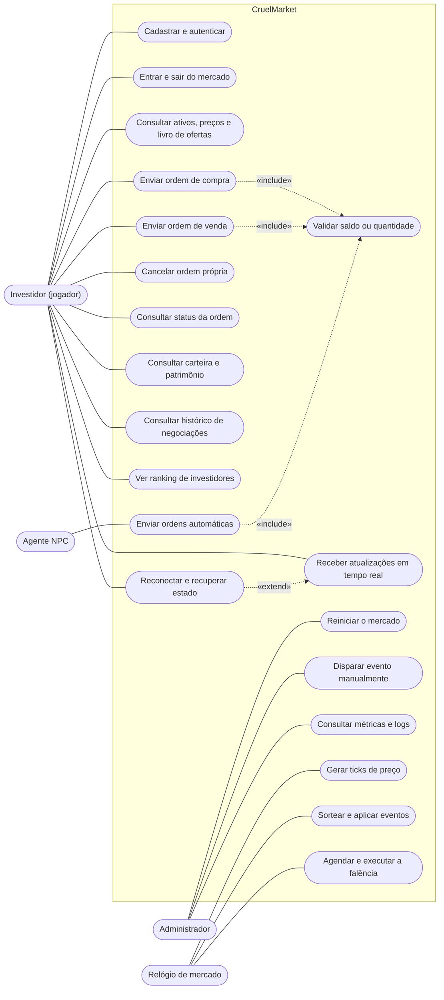
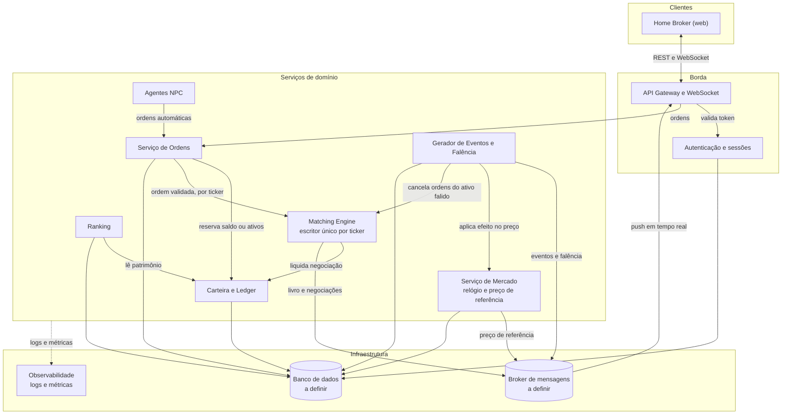
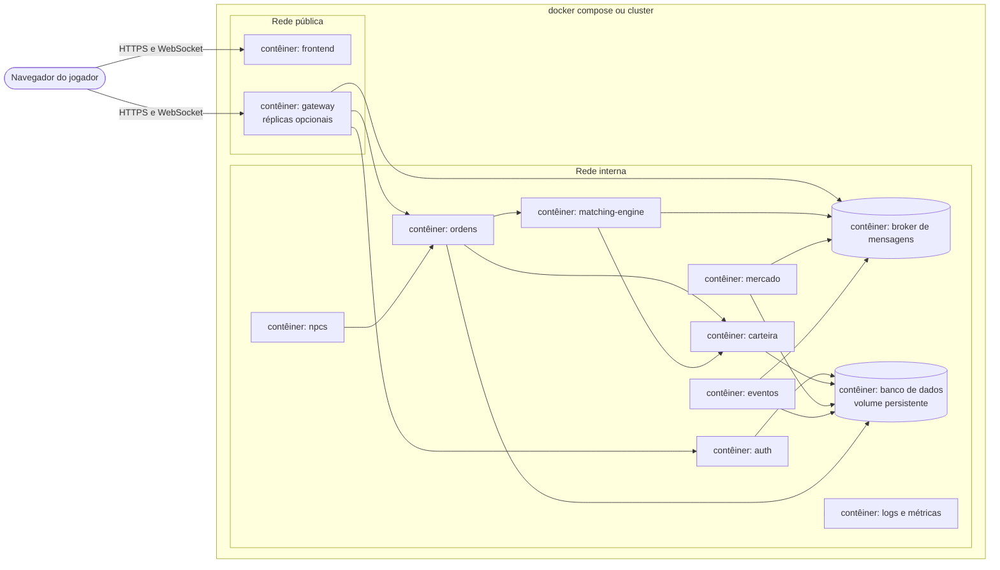
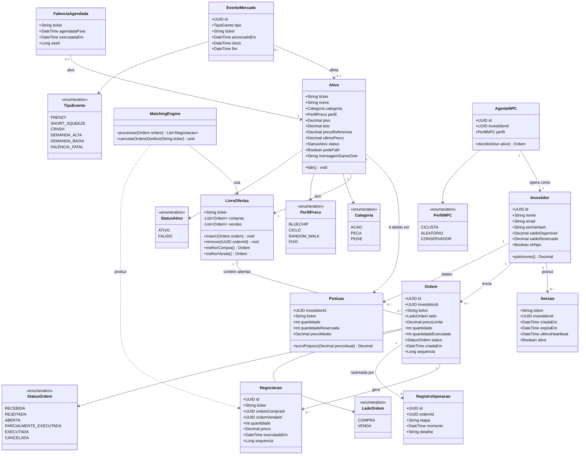
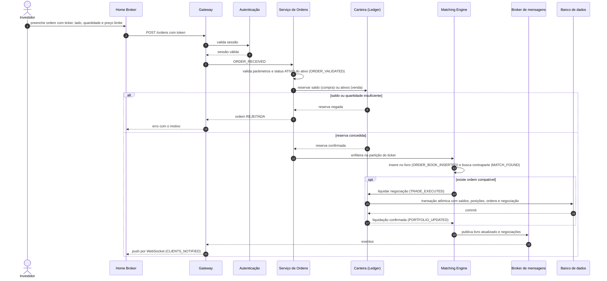
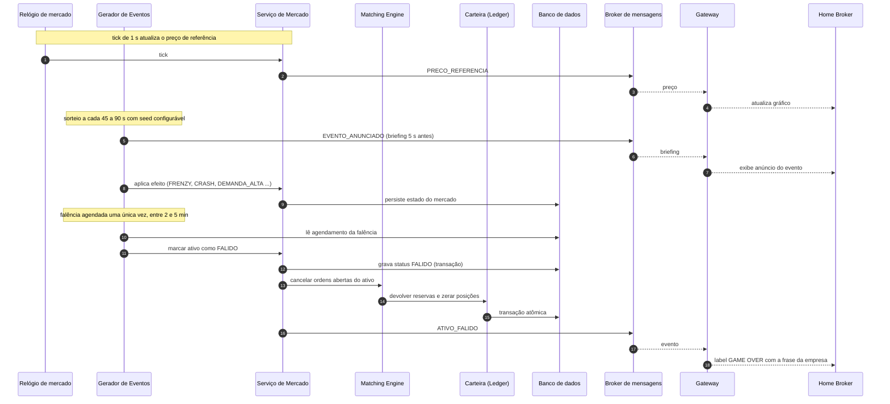
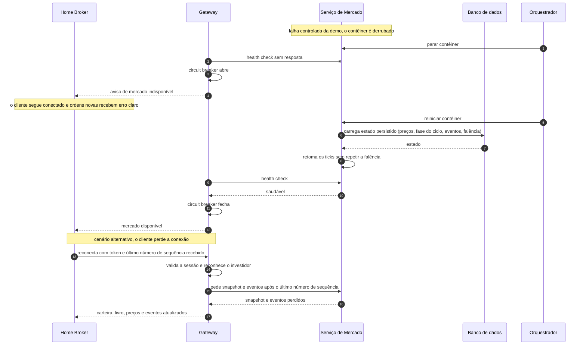
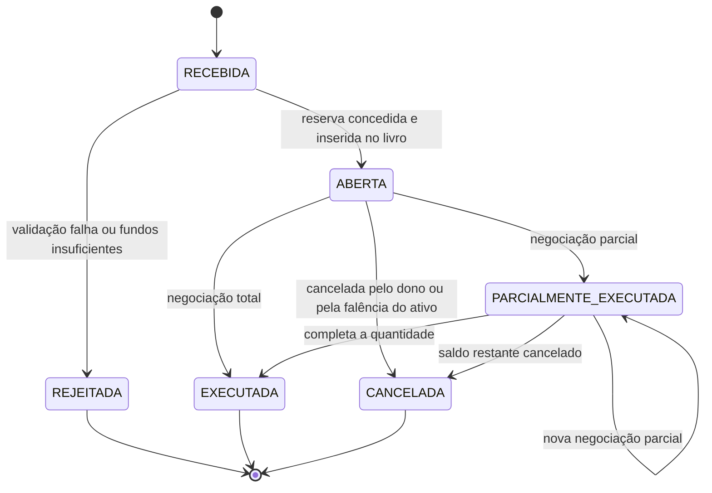
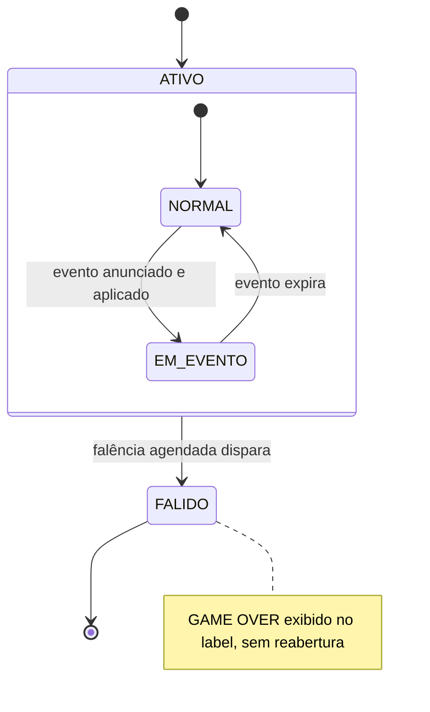
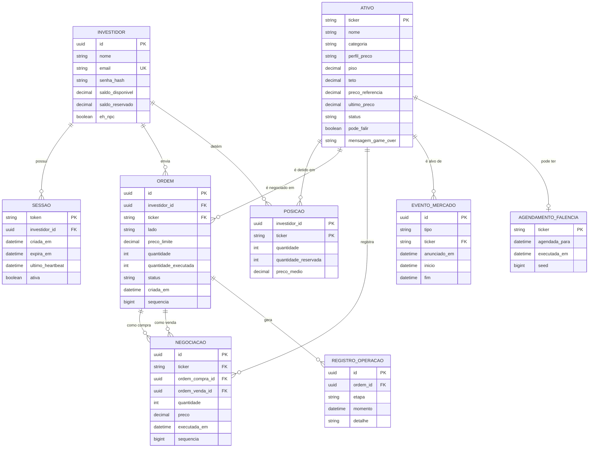

# CruelMarket: modelagem UML

Simulador de bolsa multiplayer com a temática de Cruelty Squad. Os diagramas estão em Mermaid, que o GitHub renderiza direto no repositório. Sugestão de local: `docs/uml/diagramas-uml.md`.

Premissas **(A)** a confirmar pelo grupo: apenas ordens limitadas (com preço), tecnologias de banco e de mensageria ainda por definir, e falência modelada como status do ativo, não como perfil de preço.

## 1. Casos de uso

Atores e funcionalidades do sistema. Cobre R1 a R5, R10, R11 e as seções 5, 7.4, 8 e 9 do enunciado.

## 2. Componentes e arquitetura

Serviços, fluxo de mensagens e infraestrutura. Cobre R6 a R9, R13 e R14 e a seção 7.1. O Matching Engine tem um escritor único por ticker, o que ordena as ordens sem travas distribuídas (7.3).

## 3. Implantação

Contêineres e redes (R15 e seção 7.1). Réplicas, balanceamento e cluster entram como diferencial.

## 4. Classes de domínio

Modelo de domínio com as regras do jogo (ativos com perfil de preço, eventos, falência com GAME OVER). Cobre R4 a R7 e as seções 8 e 9. A falência é o status `FALIDO` do ativo, com `mensagemGameOver` fixa por ativo.

## 5. Sequência: envio e execução de uma ordem

Fluxo observável da seção 7.8 (`ORDER_RECEIVED` até `CLIENTS_NOTIFIED`). A reserva de saldo ou de ativos impede uso duplo em ordens concorrentes (7.3). A liquidação é uma única transação atômica.

## 6. Sequência: evento aleatório e falência

Eventos sorteados com briefing antecipado e a falência única agendada, com GAME OVER no label. O agendamento é persistido para não se repetir após uma queda (RNF10).

## 7. Sequência: falha controlada e recuperação

Demonstração obrigatória da seção 15: o serviço de mercado é derrubado, o sistema detecta, reage e recupera o estado, e o cliente reconecta. Cobre R11, 7.5, RNF09 e RNF10. O circuit breaker é um diferencial.

## 8. Estados da ordem

Ciclo de vida de uma ordem, incluindo o cancelamento por falência do ativo.

## 9. Estados do ativo

Falência terminal: depois de `FALIDO` o ativo não reabre até o administrador reiniciar o mercado **(A)**.

## 10. Modelo de dados (ER)

Persistência exigida na seção 7.6: usuários, saldo, carteira, ativos, ordens, negociações e histórico de operações. Tipos genéricos, sem amarrar a tecnologia de banco.

